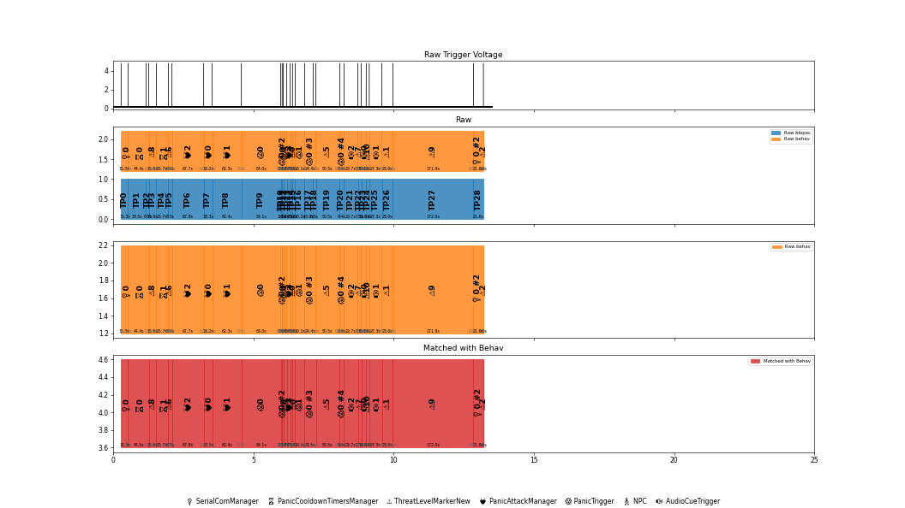
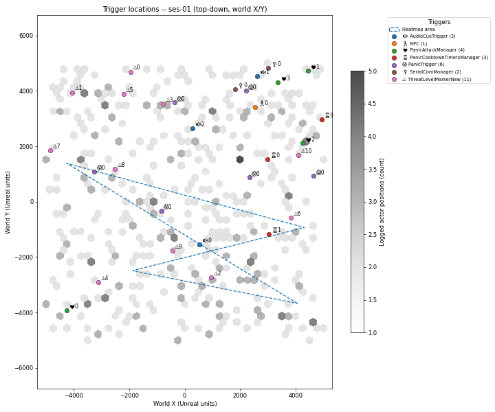
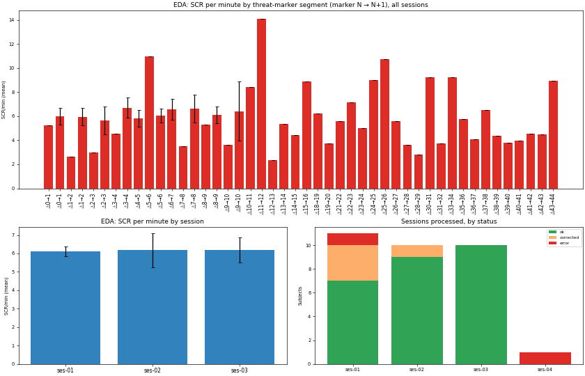

# LongwalkV3 Output Checks

{ width="72" }

This is step 3 for LongwalkV3: once your data has been
[processed](processing.md#longwalkv3), check the results before you trust
the numbers. Everything on this page is in the **LongwalkV3 Process
Results** viewer, and the same plots are saved as `.png` files in your
output folder. For how EDA and SCRs work in general, see [EDA &
SCRs](eda.md).

## Open the results viewer

Open **LongwalkV3 Process Results** from the VR Lab Toolbox launcher (or
type `vrlab_longwalk3_process_GUI` in a terminal). Point **output folder**
at the folder you processed into. If you just processed from this window,
it's already there; click **Refresh** if you processed from a terminal in
the meantime.

- **Select one subject** in the list to see their log and every QC plot,
  one tab per plot, for every session.
- **Select several subjects** (or none, for everyone) and open **Summary
  Stats** for group charts.
- Use **Zoom In**, **Zoom Out** and **Fit to Window** on any plot.

## Processing status

Every session gets a status per processing step, in the CSV as
`sesNN_Processing_Status`, e.g.
`RawBioData=ok RawLongWalkV3BehaviourData=ok RawLongWalkV3DebriefBehaviourData=ok TrialIntervals=ok`.
`Processing_Status` is the worst of all of a subject's sessions.

| Status | Meaning | What to do |
| --- | --- | --- |
| **ok** | Every trigger in the game was found on the Biopac. | Nothing. |
| **corrected** | Some game triggers had no matching Biopac trigger (e.g. the recording started late or stopped early), so their times were estimated from the triggers around them. | Look at the session's **Interval QC** plot. Usually fine; a large gap at the start or end of a recording is the usual cause. |
| **error** | That step failed, e.g. fewer than two triggers could be matched at all, or a file couldn't be read. The session has no SCR values. | Check the subject's log, and the [crosscheck](longwalkv3-crosscheck.md) for that session (wrong date, aborted run, missing file). |

## Interval QC plot (`sesNN_Interval_qc`)

This plot checks that the game's triggers line up with the triggers the
Biopac recorded, which is what every SCR value depends on.

*Synthetic example data.*

Row by row:

1. **Raw Trigger Voltage** — the Biopac's trigger channel. Each spike is
   a trigger the game sent.
2. **Raw** — blue: the intervals between Biopac triggers (`TP0`, `TP1`,
   …). Orange: the same intervals as the game logged them. Their patterns
   should look alike.
3. **Raw behav** — the game's intervals on their own, with the gap
   between each (grey numbers).
4. **Matched with Behav** — the game's intervals placed on the Biopac's
   clock, which is what processing uses.

Each interval is labelled with an **icon for the object that sent the
trigger** plus its number, e.g. ⚠2 is threat marker 2 and 🚶2 is NPC 2;
`#2` means the same object triggered again later. The key along the bottom
lists every icon in the plot. The number at the bottom of each bar is its
length in seconds.

**What to look for:** the bars in the bottom row should line up with the
spikes in the top row. Missing spikes at the very start or end (recording
started late or stopped early) give a *corrected* status, which is fine.
Bars that don't line up anywhere in the middle are worth a closer look.

## Trigger map (`sesNN_Trigger_map`)

A top-down map of the city, showing **where** each trigger happened.

*Synthetic example data.*

- **Grey hexagons** — everywhere the logged objects were during the run;
  darker means more often.
- **Dashed blue outline** — the heatmap area.
- **Coloured dots** — each trigger, at the sending object's position,
  labelled with the same icon and number as the interval plot. The legend
  counts the triggers per type.

**What to look for:** triggers where you expect them in the city, e.g.
threat markers along the walking route. A trigger far outside the area is
worth checking with whoever looks after the Unreal side.

## EDA QC plot (`sesNN_eda_qc`)

The skin-conductance signal for the whole session, with the threat-marker
segments the SCR values are counted over. See [EDA & SCRs](eda.md) for
how to read it.

## The threat-marker segments in the CSV

The SCR columns are per **threat-marker segment**: from one threat
marker's trigger to the next-numbered marker's trigger, named after the
marker it starts at. `ses01_ThreatLevelMarkerNew2_SCR_per_min` is session 1,
threat marker 2 to threat marker 3. The first marker is called just
`ThreatLevelMarkerNew` and counts as marker 1.

- A segment is only made between **consecutive** markers. If marker 4 is
  missing from a recording, there's no 3→4 and no 4→5 segment for that
  session; the subject's log says *"Threat marker 4 is missing"*.
- A marker passed twice counts from its **first** pass; the log says
  *"passed again"*.
- Other triggers (NPCs, phone, panic events, …) don't split segments.

So a missing value in an SCR column usually means that marker wasn't
reached or wasn't logged in that session. The log tells you which.

## Summary Stats

*Synthetic example data.*

- **SCR per minute by threat-marker segment** — ⚠1→2, ⚠2→3, …, all
  sessions together. With one subject selected these are their own
  values; with several, the mean with error bars (each subject counts
  once, however many sessions they have).
- **SCR per minute by session** — whether arousal changes across visits.
- **Sessions processed, by status** — per session, how many subjects came
  out ok, corrected or error.

The **Activity Log** shows the status counts, how many sessions each
subject has, and how many sessions needed estimated trigger times.

!!! note "Icons only on plots"
    The CSV and SPSS files never contain icons: their column names are the
    plain marker names above, so they open cleanly in SPSS, R or Excel.

---

**Also see:** [LongwalkV3 Crosscheck](longwalkv3-crosscheck.md) to fix a
session at the source, and [Process Your Data](processing.md#longwalkv3)
to re-process after a fix.
